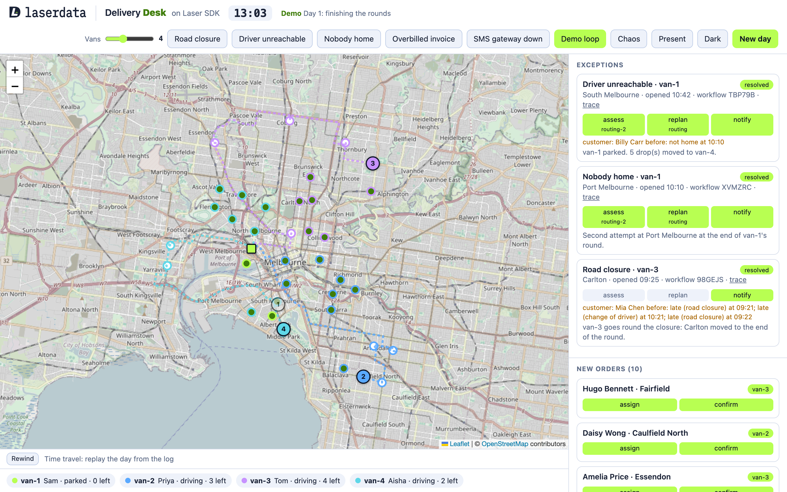

# Delivery desk on Laser SDK



A parcel delivery desk run by agents on one durable log. Four vans (two to eight, on the slider) drive their rounds on a live map. When something goes wrong (a closed road, a driver who stops answering, nobody home), dispatch spots it on the log and runs a workflow: one of two routing agents assesses it and replans the rounds, then customer tells the people affected. Customers also order during the day: dispatch gives each new order to the van that can fit it in best, and customer confirms the delivery window. At the end of the day the invoice agent checks the carrier's bill against the log and asks a person before disputing it.

Kill any agent mid-workflow and it comes back where it left off. A killed routing agent finds its saved plan and applies it. A killed dispatch resumes each open workflow from its journal and skips the steps already done.

Built on Laser SDK 0.8.2 for Python, running on Laser Stack locally or LaserData Cloud.

## What it shows

| Laser SDK | In the demo |
|---|---|
| Log | Every van's position (`fleet.positions`) and every drop, failed drop, agent step and outcome (`fleet.events`) |
| Views and change feed | Dispatch follows two queryable views of the log with `laser.watch(...)` and queries them for stopped vans and failed drops |
| Workflows | One `laser.workflow("dispatch")` run per exception: assess, replan, notify, each step a child session. The run id is kept in KV, so a restarted dispatch resumes the run from its journal |
| New orders | Each van starts the day with six drops. The other stops are customers who order during the day: the simulator puts each order on the log, and dispatch runs a two-step workflow for it, assign (routing fits it into the van with the least extra driving, counting the drops it already has) and notify (customer confirms the window). A replan that lands while an order is being placed keeps the order: rounds are merged by compare-and-swap, not overwritten |
| Agents | routing, customer and invoice, each its own process, spawned with `laser.spawn_agent(...)` |
| Agent registry | Each agent advertises the skills it serves on its card (`assess`, `replan`, `assign`, `notify`, `invoice-check`). Dispatch's workflow steps and the invoice contract name a skill, never an agent, and the registry resolves who serves it. Two routing agents (routing and routing-2) serve the same skills; dispatch's route policy picks the one it has sent the fewest steps, so the work spreads across both, and each exception card shows which one took each step. The Agent registry panel reads `laser.agent_registry()` |
| Quarantine | **Quarantine** on an agent in the registry panel appends a quarantine fact to the registry (`laser.quarantine(...)`). Every registry folds it, so dispatch routes new steps around that agent with no change to dispatch. **Reinstate** lifts it (`laser.unquarantine(...)`). The desk will not quarantine the last agent serving a skill |
| Memory | The customer agent remembers every delay and missed drop per customer on a memory topic (`laser.memory_topic(...)`) in its own stream, which a new day does not drop. When the same customer is hit again, on any later day, it recalls their history and words the SMS for it. Forget all tombstones every fact with `forget` |
| Dead letters | Every agent retries a failing task (`retry_max_attempts`), then the runtime dead-letters it and calls the agent's `dead_letter` hook, which parks it on the desk. **SMS gateway down** makes the SMS gateway reject the next notify step. **Fix and redrive** clears the fault and calls `laser.redrive_dead_letter(...)`: the original record is republished and the customer agent handles it again. If the workflow gave up meanwhile, dispatch resumes it under the same run id and the journal skips the steps already done |
| Forks | When the bill is over, the invoice agent stages the carrier's version of the day in a copy-on-write fork of the two views (`laser.fork(...)`, `put_row`): the drops and kilometres the log does not show, as speculative rows. It runs the same check against the fork with `query(...).fork(id)`. If the fork reproduces the bill, the gap is exactly those rows. The fork is squashed once the desk decides, so the real views only ever hold what the log shows |
| Time travel | Rewind replays the positions and events topics from offset 0 on a fresh cursor and rebuilds the day from the log alone. Scrub back through it minute by minute: the vans, the drops, the exceptions and the log as they were |
| Approval gate | The invoice agent pauses on `ctx.approval_gate(...)`; the desk approves or declines in the browser |
| Query | The invoice check counts drops and failed drops per van, and the furthest odometer reading per van, from the views |
| KV | Rounds, stop status, incidents, exceptions and each step's result. Writes that race use compare-and-swap; first sightings use write-if-absent |
| Crash and resume | A supervisor restarts any agent you kill, or the chaos monkey kills. The log redelivers its unfinished step; its result or saved plan in KV makes the redelivery a no-op |
| Analytics | The Readers panel: managed queries over the views for drops and kilometres per van, steps per agent, kills and redeliveries |
| Evals | Checks from the log and KV once the day is settled: every parcel delivered once, every exception resolved, every order placed on a van, every affected customer told, every kill recovered, the overbilling caught |
| Observability | OpenTelemetry traces, one per exception, across dispatch, routing and customer, in Jaeger |

## Run it

You need Python 3.11+ and Docker.

**1. Start Laser Stack**, from this directory:

```
docker compose up -d
```

This starts the Iggy server and the Laser plane from the published [Laser Stack](https://github.com/laserdata/laser-stack) images, plus Jaeger for the traces. `docker compose ps` shows `iggy` and `plane` as healthy when they are ready.

**2. Install and run:**

```
python3 -m venv .venv && . .venv/bin/activate
pip install -e .
python -m fleet.server
```

Open http://localhost:8000. The vans set off from the depot. Pick an incident from the header:

- **Road closure**: a van stops. Its round is replanned so the blocked drop comes last, and it turns back and carries on.
- **Driver unreachable**: a van is parked. Its drops move to the van that can best take them.
- **Nobody home**: the next drop fails. The parcel goes back on the van for a second attempt at the end of its round.
- **SMS gateway down**: the SMS gateway rejects the next notify step. The customer agent retries it three times, then it is dead-lettered and shows under Dead letters. **Fix and redrive** sends it through again and the customers get their messages.
- **Overbilled invoice**: when every van is back, the carrier bills for drops and kilometres the log does not show. The invoice agent asks you whether to hold the difference and dispute it.

To see crash and resume, start the server with `DESK_STEP_PAUSE=8`. The routing agent then holds for eight seconds before committing a new round. Click **Kill** on the routing agent that is holding (the exception card shows which one), or on dispatch, while it holds.

**New day** clears the stream and starts the rounds again. Each exception card links to its trace in Jaeger (http://localhost:16686).

The header also has:

- **Demo loop**: runs the day unattended, again and again. The carrier overbills, the three incidents go in at set times, approvals decide themselves after a few seconds, and a new day starts once the invoice is settled. Clicking an incident or New day stops it. `DESK_DEMO=1` starts the server with it on, and slows the mock LLM to about a second a call so people can follow the steps.
- **Chaos**: a chaos monkey that SIGKILLs a random agent every few seconds. Its kills go on the log like a Kill click, and the supervisor restarts the agent. In the demo loop it only kills while an exception or the invoice check is in flight. `DESK_CHAOS=1` starts the server with it on.
- **Vans**: how many vans run the day, from two to eight. Each starts with six drops, and the new orders are shared between them. Changing it starts a new day with that many vans; if the demo loop is on, it starts again from day 1 with them.
- **Present**: larger type for a room.

Under the map, **Rewind** rebuilds the day so far from the log and puts a slider on it. Drag it back to see the day at any minute. **Back to live** returns to the live map.

The side panel also shows the **Agent registry** (which agent serves each skill, how old its card is, and a Quarantine button on each agent) and **Customer memory** (the newest facts across days, with **Forget all**).
- **Light** or **Dark**: dark is the default look; light is for slides and screenshots.

## Without a browser

```
python -m fleet.run
python -m fleet.run --scenario not-home --no-overbill
python -m fleet.run --chaos --no-kill
```

The CLI runner starts the same processes, puts the incidents in, kills the routing agent holding a replan once, lets approvals decide themselves, and waits for the day to settle. It prints the exceptions, the invoice check, the readers and the evals, and exits non-zero if an eval failed. Stop the web demo first: both use the same stream.

## Settings

See `.env.example` for all of them.

| Variable | Default | What it does |
|---|---|---|
| `LASER_CONNECTION_STRING` | `iggy:laser@127.0.0.1:8090` | Laser Stack, or a LaserData Cloud deployment (`user:password@host` or `token@host`) |
| `DESK_STREAM` | `delivery-desk` | The stream the demo uses. It is deleted and created again at startup and on New day |
| `DESK_KEEP` | `0` | `1` keeps the stream at startup instead of starting a new day |
| `DESK_VANS` | `4` | Vans at startup, two to eight. The slider changes it on a running server |
| `DESK_JOBS` | `6` | Drops each van starts the day with |
| `DESK_ORDERS` | `10` | New orders during the day: the first `DESK_ORDER_FIRST` (15) seconds after the vans set off, then one every `DESK_ORDER_EVERY` (8) seconds |
| `DESK_MEMORY_STREAM` | `delivery-desk-memory` | The stream customer memory lives on. New day leaves it alone |
| `DESK_STEP_PAUSE` | `0` | Seconds routing holds before committing a new round, so there is time to kill it |
| `DESK_AUTO_DECIDE` | `0` | Seconds before an approval decides itself (holds and disputes), for unattended runs |
| `DESK_DEMO` | `0` | `1` starts the demo loop with the server. `DESK_DEMO_PAUSE` (10) seconds between days, `DESK_DEMO_APPROVE_DELAY` (4) before an approval decides itself |
| `DESK_CHAOS` | `0` | `1` starts the chaos monkey with the server. It kills one of `DESK_CHAOS_AGENTS` (all five agents) every `DESK_CHAOS_MIN` to `DESK_CHAOS_MAX` seconds (3 to 10) |
| `DESK_OTEL` | `1` | `0` turns tracing off. Traces go to `OTEL_EXPORTER_OTLP_ENDPOINT` (http://localhost:4318); with nothing listening there, tracing turns itself off |
| `DESK_LLM` | `mock` | `claude` (Claude Code's `claude -p`) or `api` (needs `ANTHROPIC_API_KEY`) to write the summaries and customer messages |
| `DESK_TICK`, `DESK_SPEED`, `DESK_DWELL` | `0.5`, `120`, `4` | Seconds per tick, metres a van moves per tick, ticks spent at each drop |
| `DESK_PORT` | `8000` | The web server's port |

## Roads

The vans follow real roads. `fleet/data/roads.json` holds the road route between every pair of places (the depot and the 60 stops), from OpenStreetMap data, fetched once with `scripts/fetch_roads.py` from the public OSRM demo router. The demo reads the file and calls no routing service. Run the script again after adding stops in `fleet/config.py`: it fetches only the legs the file does not have, routing out and back from one place to 12 others per request.

The map tiles come from OpenStreetMap, so the browser needs internet access.

## Layout

```
fleet/config.py      the city, vans, stops, scenarios and settings
fleet/sim.py         the world: vans driving their rounds and playing incidents (python -m fleet.sim)
fleet/agents.py      dispatch, routing, customer and invoice (python -m fleet.agents <name>)
fleet/plan.py        route planning, no I/O
fleet/roads.py       the saved road routes
fleet/core.py        the connection, topics, views and KV helpers every process shares
fleet/supervisor.py  starts the processes and restarts any that die
fleet/chaos.py       the chaos monkey: kills a random agent now and then
fleet/demo.py        the demo loop: whole days, unattended
fleet/memory.py      customer memory: remember, recall and forget, per customer
fleet/timeline.py    time travel: the day rebuilt from the log
fleet/telemetry.py   OpenTelemetry, by hand (Laser SDK's Python package has none yet)
fleet/server.py      the web demo, the approval desk, the readers and the evals
fleet/run.py         the CLI runner
fleet/static/        the page and the LaserData logo
scripts/fetch_roads.py  fetches fleet/data/roads.json
tests/               route planning, fleet size, timeline and memory tests (python -m unittest discover tests)
logs/                each process's output
```

## Known limits

- The customers, the carrier and its rates are made up.
- A van that is rerouted mid-leg turns back to the last place it was at before taking the new road.
- The planner is nearest-neighbour, which is good enough for five to ten drops a van.
- Rewind reads both topics from the start each time, which is fine for a day of a few thousand records.
- A rewound minute shows what is on the log: positions, drops, failed drops, exceptions and agent steps. Routes in KV have no history, so the planned road ahead is not drawn while rewound.
- Quarantine only changes routing. A step already sent to the agent before it was quarantined is still done by that agent.
- The what-if fork needs a deployment that serves forks (`capabilities().forks`). Where it does not, the check carries on without it and says so on the log.
- Customer memory recall reads the read view Laser Stack folds from the memory topic, so a fact can take a moment to show up.
- Python has no OTEL package in Laser SDK yet, so tracing is hand-rolled with the OpenTelemetry SDK. A dispatch killed mid-workflow loses the open root span, so that trace shows the steps without their parent.
